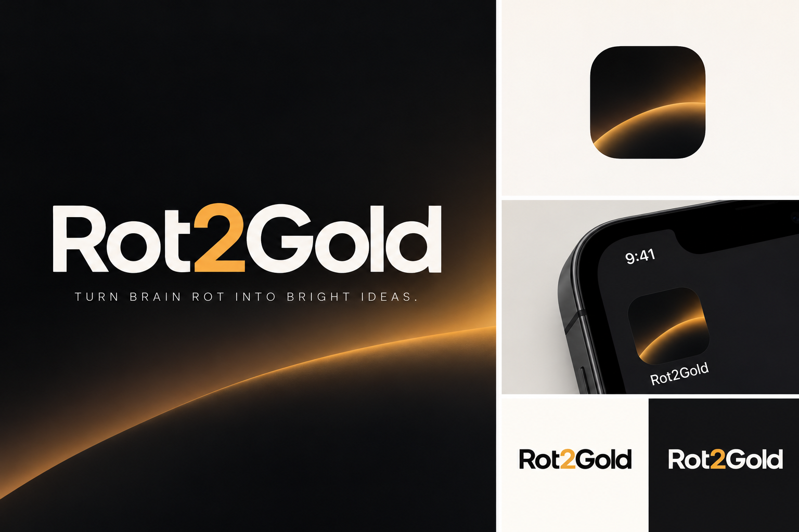

# Rot2Gold

**Turn the TikTok videos you save into notes, ideas, learnings and events in your Obsidian vault.**



You save videos because something in them seemed worth keeping, and then they disappear into a collection you never open again. Rot2Gold reads that collection and, for every video:

1. downloads it once, reads the text on screen (OCR) and transcribes the speech, all on your computer;
2. has an AI write a note in your vault: the creator's words cleaned up, the key points, the claims checked against sources, context and other perspectives;
3. looks across all your notes for **ideas** (things you could do), **learnings** (things the videos teach) and **events** (things that happened or are coming up), and grows them as more videos point the same way.

Everything is plain Markdown in your vault. A small local app (it runs in your browser at `http://127.0.0.1:8740`) shows your ideas, learnings, events and videos, and runs each Extract.

## What you need

- **[Obsidian](https://obsidian.md)** and a vault (any folder of notes works).
- **One AI option** (setup tells you which ones it finds):

  | Option | What you need | Notes |
  |---|---|---|
  | [Claude Code](https://claude.com/claude-code) | a Claude subscription, or an Anthropic API key | the best notes, with web search |
  | [Codex CLI](https://github.com/openai/codex) | a ChatGPT plan, or an OpenAI API key | with web search |
  | [Gemini CLI](https://github.com/google-gemini/gemini-cli) | a Google account (free tier), or a Gemini API key | with web search |
  | A local model: [Ollama](https://ollama.com), [LM Studio](https://lmstudio.ai) or llama.cpp | a computer that can run one (8B or larger works best) | free and private; no web search, so notes are simpler |

- **Tesseract**, to read text on screen (recommended; without it only speech is used):

  | System | Command |
  |---|---|
  | macOS | `brew install tesseract tesseract-lang` |
  | Windows | `winget install UB-Mannheim.TesseractOCR` |
  | Debian, Ubuntu | `sudo apt install tesseract-ocr` |
  | Fedora | `sudo dnf install tesseract` |

Everything else (Python, ffmpeg, the downloaders, the speech model) comes with the install.

## Install

**[SETUP.md](SETUP.md) walks through the whole setup on macOS, Windows and Linux**: Obsidian, Git and uv, each AI option, Tesseract, the setup page, browser cookies for private collections, where files go, and what to do if something goes wrong. The short version:

Rot2Gold installs with [uv](https://docs.astral.sh/uv/), which also brings the right Python. uv needs [Git](https://git-scm.com) to download it (`git --version` tells you if it's there).

**macOS and Linux**

```sh
curl -LsSf https://astral.sh/uv/install.sh | sh
uv tool install git+https://github.com/MarcoSburlino/rot2gold
r2g
```

**Windows** (PowerShell)

```powershell
powershell -ExecutionPolicy ByPass -c "irm https://astral.sh/uv/install.ps1 | iex"
uv tool install git+https://github.com/MarcoSburlino/rot2gold
r2g
```

If `r2g` isn't found right after installing uv, open a new terminal first (or run `uv tool update-shell`).

## First run

`r2g` opens the app in your browser, and the first time it shows the setup:

1. **What's on this computer:** which AI tools and Tesseract it finds, and how to install what's missing.
2. **Your vault:** the vaults Obsidian knows, or any folder. Rot2Gold writes only in its own folder there (`Rot2Gold/` by default, with `Videos`, `Ideas`, `Learnings`, `Events` and `Templates` inside).
3. **Where to keep videos and other content:** frames, slide images and the app's database, outside the vault.
4. **Who writes the notes,** the model, and the language your notes are written in.
5. **Languages on screen** for OCR.
6. **Your first collection** (optional) and the browser you're logged into TikTok with, in case it's private.

It can also add Rot2Gold to your app menu. You can run the setup again any time from **Settings → About**, or in a terminal with `r2g setup`.

## Using it

- **Add a collection:** open it on TikTok, copy its address, and paste it under **Collections** (the **+**).
- **Extract new videos:** reads every collection, processes new videos, writes their notes, then looks for ideas, learnings and events. The first run on a big collection takes a while; it stops politely at the AI's usage limit and carries on next time.
- **Read in Obsidian or in the app.** Each idea, learning and event lists the videos behind it. Mark them with `status:` in Obsidian (`trying`, `kept`, `dropped`, `going` for events).
- **Change the format:** edit the templates in your vault's `Rot2Gold/Templates/`, or point **[vault] rules** in your config at a note with your own rules for the AI.
- **Undo:** if your vault is a Git repository, every run is committed and can be undone from **History**.

## Privacy and limits

- Everything stays on your computer except what you send to your AI provider (the post's text and transcript, and its frame image). With a local model nothing leaves your computer except the TikTok downloads.
- API keys go in your system keychain, never in a file.
- Rot2Gold never fetches captions, hashtags or comments, and it downloads slowly on purpose.
- It's meant for your own saved collections, for personal use. Respect TikTok's terms and the creators' rights: the notes quote creators so you can find and credit them.

## Updating and removing

```sh
uv tool upgrade rot2gold        # a new version of Rot2Gold
r2g update-downloaders          # newer yt-dlp and gallery-dl, when TikTok downloads start failing
r2g uninstall-launcher          # remove it from the app menu
uv tool uninstall rot2gold      # remove the app; your notes and data folder stay
```

## Commands

| Command | Does |
|---|---|
| `r2g` | open the app (setup the first time) |
| `r2g setup` / `r2g setup --check` | answer the setup questions in a terminal / show where things are and what's installed |
| `r2g extract` | the same as the Extract button |
| `r2g conn list`, `r2g conn add <link>` | collections |
| `r2g runs`, `r2g undo <run>` | history and undo |
| `r2g install-launcher` | add the app to your app menu |

`r2g --help` lists the rest.

## Settings

Defaults live in the app; your choices go in `config.toml` in your config folder (`r2g setup --check` shows where). Most of them are in **Settings** in the app. Notable ones:

- `[vault]`: the folders the app writes, Git on or off, commands to run after each write (for example to rebuild an index).
- `[ai]` and `[notes]`: the provider, models, batch sizes, note language, example notes from your vault for the AI to match.
- `[ocr]`: languages and where Tesseract is, if it isn't found by itself.

## Contributing

See [CONTRIBUTING.md](CONTRIBUTING.md). Design notes and decisions are in `docs/`.

## Licence

[Apache License 2.0](LICENSE). The bundled fonts are under the SIL Open Font License (see [NOTICE](NOTICE)).
